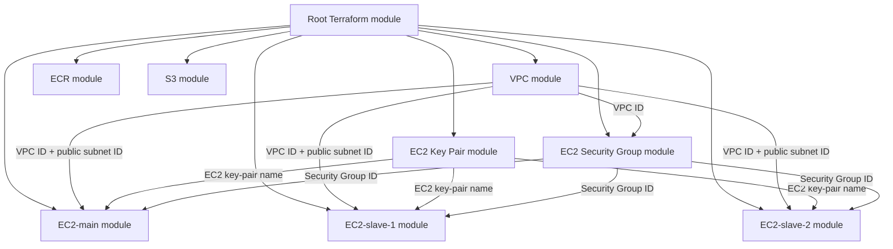

# Infrastructure Work — AWS Infrastructure with Terraform

[](https://www.terraform.io/)
[](https://aws.amazon.com/)
[](#license)

A modular Infrastructure as Code (IaC) project that provisions foundational AWS resources using Terraform. The repository separates networking, compute, container image storage, object storage, SSH key generation, and security-group configuration into reusable child modules.

> **Important:** This README documents the repository's current configuration as inspected. It also calls out configuration issues that should be reviewed before deploying. It does not claim that the current configuration is production-ready.

## Contents

- [Project overview](#project-overview)
- [Architecture](#architecture)
- [Repository structure](#repository-structure)
- [Modules](#modules)
- [Prerequisites](#prerequisites)
- [AWS authentication](#aws-authentication)
- [Remote state bootstrap](#remote-state-bootstrap)
- [Deploy](#deploy)
- [Inspect outputs](#inspect-outputs)
- [Destroy resources](#destroy-resources)
- [Security notes](#security-notes)
- [Configuration review and known issues](#configuration-review-and-known-issues)
- [Troubleshooting](#troubleshooting)
- [Author](#author)

## Project overview

The root Terraform configuration composes these child modules:

| Component | Purpose |
|---|---|
| VPC | Creates a VPC, public and private subnets, an Internet Gateway, route tables, and subnet associations |
| EC2 | Creates reusable EC2 instances from a shared instance module |
| Key Pair | Generates an RSA private/public key pair, registers the public key with EC2, and writes the private key to a local PEM file |
| Security Group | Defines inbound rules for HTTP, HTTPS, SSH, and Jenkins, plus an outbound rule |
| ECR | Creates an Amazon Elastic Container Registry repository and configures image tag mutability and scan-on-push |
| S3 | Creates an S3 bucket, an object key, versioning, and public-access-block settings |

The root module currently declares three EC2 module instances: one main server and two worker/slave servers. The two slave instances override the default instance type to `t2.medium`.

## Architecture



The S3 backend configured in `terraform.tf` is initialized before normal module resources are created. Therefore, the backend bucket must already exist before `terraform init`; see [Remote state bootstrap](#remote-state-bootstrap).

## Repository structure

The structure below reflects the root files and module paths inspected in the repository. GitHub paths are case-sensitive.

```text
Infrastructure-Work/
├── Modules/
│   ├── EC2/
│   │   ├── Key/
│   │   │   ├── main.tf
│   │   │   ├── variables.tf
│   │   │   └── output.tf
│   │   ├── Security/
│   │   │   ├── main.tf
│   │   │   ├── variables.tf
│   │   │   └── output.tf
│   │   ├── main.tf
│   │   ├── variables.tf
│   │   └── output.tf
│   ├── ECR/
│   │   ├── main.tf
│   │   ├── variables.tf
│   │   └── output.tf
│   ├── S3/
│   │   ├── main.tf
│   │   ├── variables.tf
│   │   └── output.tf
│   └── VPC/
│       ├── main.tf
│       ├── variables.tf
│       └── output.tf
├── .gitignore
├── .terraform.lock.hcl
├── main.tf
├── output.tf
├── providers.tf
├── terraform.tf
└── variables.tf
```

> The repository's root `main.tf` currently uses `source = "./modules/s3"` for the S3 module, while the inspected directory is `Modules/S3`. On case-sensitive filesystems, this path does not resolve. Correct the source path to match the real directory exactly.

## Modules

### 1. VPC — `Modules/VPC`

Creates:
- One VPC using a configurable CIDR block.
- One public subnet and one subnet named private.
- An Internet Gateway.
- Public and private route tables.
- Route-table associations for both subnets.

The current route-table configuration sends `0.0.0.0/0` through the Internet Gateway in **both** route tables. Consequently, the subnet named `private` is not isolated from direct Internet routing. A genuinely private subnet normally has no direct route to an Internet Gateway; if outbound Internet access is required, it commonly uses a NAT Gateway or another controlled egress design.

### 2. EC2 — `Modules/EC2`

Creates one EC2 instance using input variables for:
- AMI ID.
- Instance type.
- Subnet ID.
- Security Group ID.
- EC2 key-pair name.
- Instance Name tag.

The root module calls this reusable module three times:
- `EC2-main`
- `EC2-slave-1`
- `EC2-slave-2`

The two slave calls set `ec2-type = "t2.medium"` and custom Name tags. The main server uses the child module defaults unless overridden.

### 3. Key Pair — `Modules/EC2/Key`

Uses the TLS provider to generate a 4096-bit RSA key pair. It registers the OpenSSH public key with AWS as an EC2 key pair and writes the private key to a local `.pem` file with file permission `400`.

**Protect the PEM file.** Never commit it, publish it, or share it. The private key is sensitive and should be backed up securely. If it has been exposed, replace the key pair and remove the compromised key from use.

### 4. Security Group — `Modules/EC2/Security`

Creates a Security Group in the VPC passed by the root module. Current ingress rules cover:
- HTTP: TCP 80
- HTTPS: TCP 443
- SSH: TCP 22
- Jenkins: TCP 8080

The current default CIDR is `0.0.0.0/0`, which exposes these ports to all IPv4 addresses. Restrict SSH and Jenkins to trusted administrator or VPN IP ranges. Public web access may be appropriate for a public web service, but should be an intentional decision.

The current egress configuration also needs correction; see [Configuration review and known issues](#configuration-review-and-known-issues).

### 5. ECR — `Modules/ECR`

Creates an Amazon ECR repository. Its inputs configure the repository name, image tag mutability, and whether image scanning runs when images are pushed.

Use a repository name that follows ECR naming requirements: lowercase letters, numbers, and permitted separators. Avoid uppercase characters and spaces.

### 6. S3 — `Modules/S3`

Creates an S3 bucket, an object resource using the configured key, enables bucket versioning, and configures public-access-block settings.

Review the public-access-block values carefully. The current configuration sets `block_public_policy` and `restrict_public_buckets` to `false`; this is less restrictive than the usual secure default. Keep public access blocked unless the project has a reviewed requirement to expose bucket content.

## Prerequisites

Install and configure:

1. [Terraform CLI](https://developer.hashicorp.com/terraform/install) compatible with the project's provider constraints.
2. [AWS CLI](https://docs.aws.amazon.com/cli/latest/userguide/getting-started-install.html).
3. An AWS account and an IAM identity allowed to create the resources used by this project.
4. Git.
5. A pre-created S3 bucket for the configured Terraform backend.

Check the installed tools:

```bash
terraform version
aws --version
git --version
```

## AWS authentication

Configure credentials using an AWS CLI profile or another supported AWS credential provider. For a local profile:

```bash
aws configure
aws sts get-caller-identity
```

The identity check should return the AWS account and caller ARN. Do not hardcode AWS access keys in `.tf` files or commit credentials to Git.

If using a named profile:

```bash
export AWS_PROFILE=your-profile-name
```

## Remote state bootstrap

The current `terraform.tf` configures an S3 backend with:

- Bucket: `hospital-management-s3-bucket`
- State key: `terraform.tfstate`
- Region: `us-east-1`
- Encryption: enabled

**The backend bucket must exist before `terraform init`.** Terraform initializes the backend before it can create resources from the root module. The S3 child module cannot create the same bucket early enough to satisfy backend initialization.

Create the backend bucket separately (or use an existing approved bucket), verify its region and access permissions, and then initialize Terraform. For production/team use, enable versioning and consider a state-locking strategy supported by your Terraform version and backend configuration.

Do not casually change the backend bucket or key after state exists. Use Terraform's documented backend migration workflow and take a secure backup first.

## Deploy

Run commands from the repository root, where the root `main.tf` and `terraform.tf` are located.

```bash
# 1. Clone the repository
git clone https://github.com/Engg-Sayed-Abdul-Qayum/Infrastructure-Work.git
cd Infrastructure-Work

# 2. Authenticate to AWS (if not already configured)
aws sts get-caller-identity

# 3. Initialize providers, modules, and the configured backend
terraform init

# 4. Check formatting
terraform fmt -recursive -check

# 5. Validate Terraform configuration
terraform validate

# 6. Review the proposed infrastructure changes
terraform plan

# 7. Apply only after reviewing the plan
terraform apply
```

To automatically approve an apply, Terraform supports `terraform apply -auto-approve`; use this only in a controlled environment after reviewing the plan. It is not recommended as the default for learning or production workflows.

## Inspect outputs

The root `output.tf` currently contains commented-out output blocks, so it does not expose those values at the root level. Child modules define outputs such as EC2 instance IDs and IP addresses, VPC and subnet IDs, ECR repository URL, S3 bucket information, and key-pair name.

To make a child-module value visible at the root, add an active root output that references the corresponding module output. Then run:

```bash
terraform output
```

For sensitive values, avoid printing or sharing them in logs, screenshots, CI output, or chat messages.

## Destroy resources

Review the resources first:

```bash
terraform plan -destroy
```

Destroy only when you are certain the resources and their data are no longer needed:

```bash
terraform destroy
```

Destroying an S3 bucket may fail if it contains objects or versions. Back up anything important and empty the bucket safely before destroying it. Also consider whether the S3 backend bucket should be retained independently of the infrastructure managed by this root module.

## Security notes

- Never commit `.pem` private keys, AWS credentials, Terraform state, plan files, or secret variable files.
- Keep `.terraform.lock.hcl` in Git so provider selections and checksums remain consistent.
- Restrict SSH (22) and Jenkins (8080) ingress to trusted source IP ranges.
- Keep S3 public access blocked unless public access is explicitly required and reviewed.
- Use private subnets for resources that should not receive direct Internet traffic.
- Prefer IAM roles/instance profiles over long-lived access keys where applicable.
- Treat Terraform state as sensitive even when the backend uses encryption.
- Review every `terraform plan` before applying.

## Configuration review and known issues

The following items were identified in the repository's inspected Terraform source. They are review findings, not changes automatically applied by this documentation package.

| Priority | File | Finding | Recommended review |
|---|---|---|---|
| High | `main.tf` | S3 module source uses `./modules/s3`, but the repository path is `Modules/S3` | Change the source path to the exact directory casing |
| High | `terraform.tf` + `Modules/S3` | The backend bucket is configured in the same project that declares an S3 bucket module | Create the backend bucket before `terraform init`; use a separate bootstrap stack |
| High | `Modules/VPC/main.tf` | The route table named private also routes `0.0.0.0/0` to the Internet Gateway | Remove direct IGW routing from the private route table; add NAT only if required |
| High | `Modules/VPC/variables.tf` | Default VPC CIDR is `120.0.0.0/16`, which is not in the RFC1918 private IPv4 ranges | Consider a non-overlapping private range such as `10.0.0.0/16`, `172.16.0.0/12`, or `192.168.0.0/16` |
| High | `Modules/EC2/Security/variables.tf` | Default ingress CIDR is `0.0.0.0/0` for SSH and Jenkins too | Restrict administrative ports to trusted IP ranges |
| High | `Modules/EC2/Security/main.tf` | Egress `protocol` is set from `SG-outbound-port`, while a separate `SG-Outbound-Protocol` variable exists but is not used | Correct protocol and port semantics; use protocol `-1` with ports `0`/`0` for all protocols, or explicit protocol/port rules |
| Medium | `Modules/EC2/Security/variables.tf` | Several port/protocol values are declared as strings | Prefer numeric port types and a clearly typed protocol string |
| Medium | `Modules/ECR/variables.tf` | `push` is a string although `scan_on_push` is boolean | Change the variable type to `bool` and default to `true`/`false` as a boolean |
| Medium | `Modules/S3/main.tf` | The S3 object declares a bucket and key but no visible content/source input | Verify the AWS provider's required arguments and define the intended object content/source |
| Medium | `Modules/S3/main.tf` | Public-access-block settings permit public bucket policies | Keep the restrictive settings enabled unless there is a documented public-access requirement |
| Medium | `Modules/EC2/variables.tf` | `VPC-EC2-ID` is declared and passed by the root but is not referenced by the EC2 resource | Remove the unused input or use it where the module needs it |
| Medium | `output.tf` | All root output blocks are commented out | Add active root outputs for the values that should be visible after apply |

### Private IPv4 CIDR reminder

The commonly used private IPv4 ranges are:

- `10.0.0.0/8`
- `172.16.0.0/12`
- `192.168.0.0/16`

A VPC should use a range that does not overlap with networks it needs to connect to.

## Troubleshooting

**Backend initialization fails**

- Confirm that `hospital-management-s3-bucket` already exists in `us-east-1`.
- Confirm the AWS identity has permission to access the bucket.
- Confirm the backend bucket and key are correct.

**Terraform cannot find the S3 module**

- Check the exact directory capitalization.
- Make the root module source match `Modules/S3` exactly.

**AWS reports an invalid ECR repository name**

- Use lowercase letters and numbers.
- Use only supported separators between name segments.
- Avoid spaces and uppercase characters.

**EC2 cannot be reached over SSH**

- Confirm the instance is running and has a public IP if connecting over the Internet.
- Confirm the subnet routing and Internet Gateway setup.
- Confirm the Security Group permits TCP 22 from your current trusted public IP.
- Confirm the matching private PEM key is present and has restrictive permissions.

**Terraform reports a state lock or state access issue**

- Check backend permissions and any active Terraform process.
- Do not delete or overwrite state files as a first troubleshooting step.
- Back up state before attempting state recovery or backend migration.

## Author

**Engg. Sayed Abdul Qayum**

- GitHub: [Engg-Sayed-Abdul-Qayum](https://github.com/Engg-Sayed-Abdul-Qayum)
- Repository: [Infrastructure-Work](https://github.com/Engg-Sayed-Abdul-Qayum/Infrastructure-Work)

## License

No license file was visible in the inspected repository. Add a `LICENSE` file if you want to define how others may use, modify, and distribute this project.
